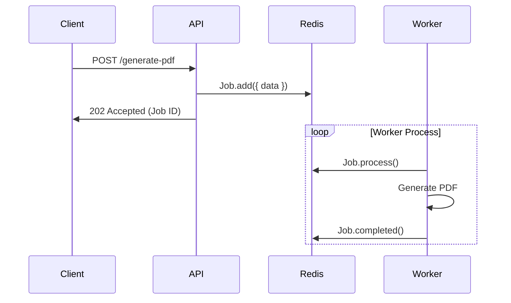

# Scaling with Redis Queues

## The Pattern
When an API request initiates a heavy task (e.g., "Generate PDF Report"), we cannot block the HTTP response waiting for it.

## Architecture with BullMQ

## Key Concepts
1.  **Producer**: Adds jobs to the queue.
2.  **Consumer (Worker)**: Processes jobs. Can be scaled horizontally.
3.  **Concurrency**: Control how many jobs a single worker processes in parallel.
4.  **Rate Limiting**: Ensure we don't overwhelm downstream services (e.g., 3rd party APIs).

## Handling Failures
-   **Automatic Retries**: Exponential backoff for transient errors (network blips).
-   **Dead Letter Queue**: If a job fails max retries, it moves here for manual inspection so it doesn't clog the main queue.
