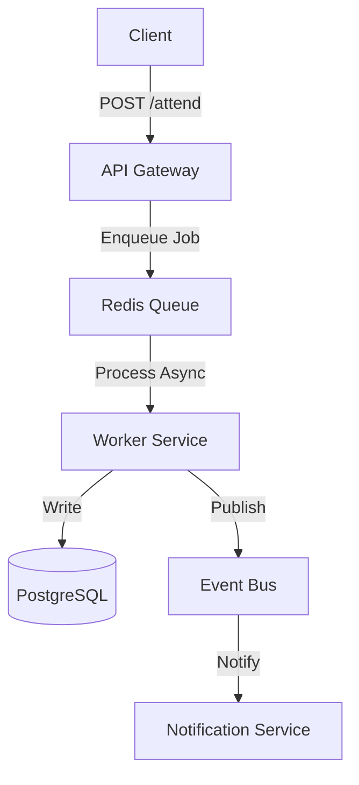

# Event-Driven Attendance System

## Overview
Based on my experience building a high-volume attendance system capable of handling **1M+ concurrent users** during short bursts (e.g., event check-ins). The system prioritizes **availability** and **write throughput** over immediate read consistency.

## Architecture

## Key Components

### 1. Ingestion Layer
- **Node.js API**: Lightweight, stateless layer that performs basic validation and immediately pushes the request to a Redis queue.
- **Queueing**: We used **BullMQ** (Redis-based) to buffer the burst traffic. This decoupled the ingestion from the heavier database writes.

### 2. Processing Layer
- **Worker Pool**: Scalable pool of workers that consume jobs from the queue.
- **Idempotency**: Processing handles duplicate webhooks or retries gracefully using a composite key (user_id + event_id).

### 3. Data Storage
- **PostgreSQL**: Primary source of truth.
- **Partitioning**: Tables partitioned by time (monthly) to keep indexes small and efficient.

## Challenges & Solutions

### The "Thundering Herd"
**Problem**: 500k users trying to mark attendance within a 5-minute window caused DB connection exhaustion.
**Solution**: Implementing the queue buffer. Users got an immediate "Request Received" (HTTP 202) response. The actual DB write happened asynchronously.

### Data Consistency
**Problem**: Users refreshing the page didn't see their attendance marked immediately.
**Solution**: Optimistic UI updates on the client side, coupled with a WebSocket notification when the background job completed.
