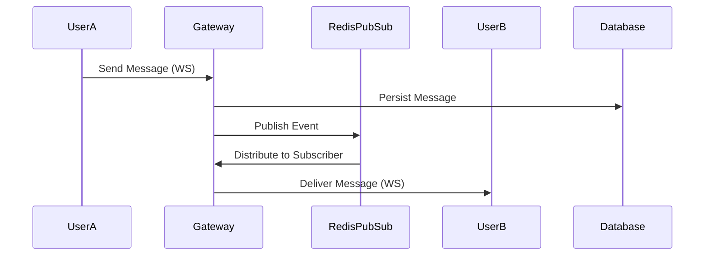

# Real-Time Chat System

## Overview
A scalable 1-to-1 and group chat system designed for reliability and order guarantees.

## Architecture

## Core Features

### 1. Delivery Guarantees
We implemented an **Ack-based** delivery system.
- Server sends message -> Client sends Ack.
- If no Ack received within 5s, server retries or marks as failed.

### 2. Message Ordering
Using **lexicographical KSUIDs** (K-Sortable Unique IDs) allowed us to sort messages by time without relying on potentially drifting server clocks.

### 3. Presence System
- **Heartbeats**: Clients send a heartbeat every 30s.
- **Redis Sets**: Active users are stored in Redis Sets with a TTL.
- **Status Broadcasting**: Changes in status are batched and broadcasted to friends to avoid notification storms.

## Scaling WebSocket Connections
We used a **sticky session** load balancer to ensure a user always connects to the same server node during a session, but the Pub/Sub layer allows any user to message any other user regardless of which node they are connected to.
